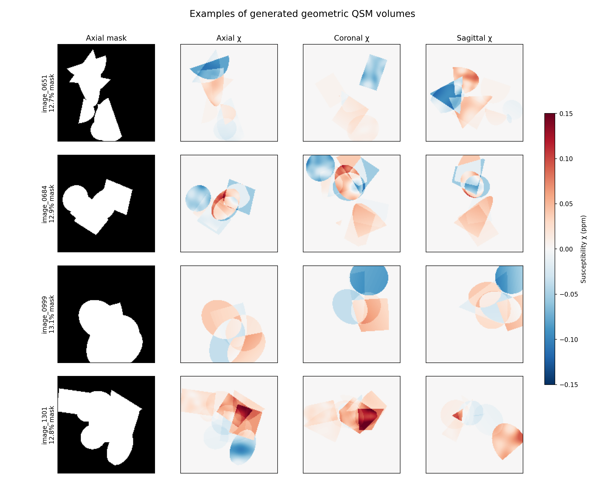
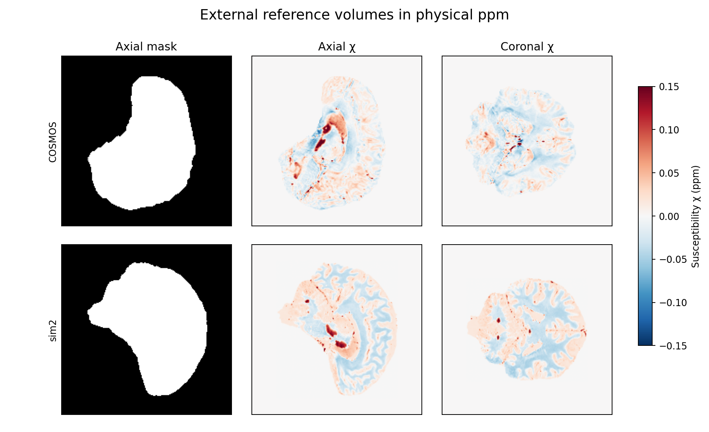
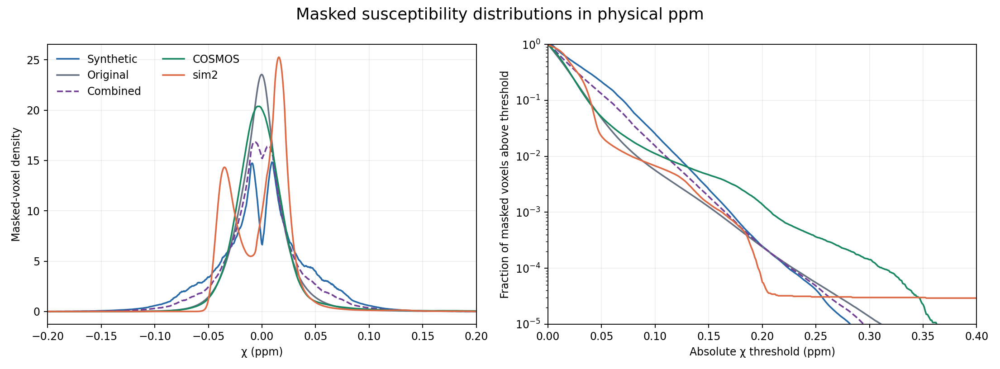

# Geometric QSM data: susceptibility distribution report

**Dataset snapshot:** 2 October 2026. The joint training directory contains 651 original and 651 generated mask/χ pairs. Each pair is a `[1, 160, 160, 160]` tensor. The generated volumes use 4–12 overlapping, randomly oriented ellipsoids, cylinders, cuboids, and cones. Their union defines the mask; signed constant, gradient, and smooth-texture χ contributions add where shapes overlap.

## Method

All statistics use susceptibility **inside the mask**, with every selected voxel weighted equally. The original and generated training tensors are analyzed as saved, before the training loader's random 0.5–3 susceptibility scaling. Values are reported in ppm. The COSMOS comparison uses the completed SNR=100/background=10 simulation selected by `load_cosmos_case()`; its χ is multiplied by the saved factor 0.2125 to restore ppm. The sim2 comparison uses `Sim2ChiGT.nii.gz` through `load_sim2_case()`; multiplying solver χ by 0.264 restores the NIfTI values in ppm. Both references are single volumes, so they describe those cases rather than a population distribution.

Percentiles come from 0.0005 ppm histogram bins. The plotted density is smoothed over 0.0105 ppm for readability; the table and tail probabilities use unsmoothed counts. The exact statistics and source paths are in [statistics.json](figures/synthetic_data/statistics.json). Regenerate the figures and statistics with `uv run python scripts/report_synthetic_data.py` from the repository root.

## Visual examples

The four generated examples below show the axial union mask and three χ planes. Slices were chosen at the largest mask cross-section for each orientation. Red is positive χ, blue is negative χ, and all χ panels share a ±0.15 ppm display range. Overlaps can strengthen or cancel susceptibility; gradients and smooth textures vary values inside individual primitives.

The corresponding reference views show the finer anatomical patterns and contiguous masks in COSMOS and sim2, using the same χ display range.

## Masked susceptibility distributions

| Cohort | Volumes | Masked voxels | Mean ± SD (ppm) | 1st / 99th percentile (ppm) | \|χ\| > 0.05 ppm | \|χ\| > 0.10 ppm |
| --- | ---: | ---: | ---: | ---: | ---: | ---: |
| Generated | 651 | 355.9 M | +0.0005 ± 0.0417 | −0.1051 / +0.1050 | 21.55% | 2.54% |
| Original | 651 | 366.7 M | −0.0001 ± 0.0249 | −0.0580 / +0.0773 | 4.80% | 0.56% |
| Combined training set | 1,302 | 722.6 M | +0.0002 ± 0.0342 | −0.0904 / +0.0968 | 13.05% | 1.53% |
| COSMOS | 1 | 0.93 M | ≈0 ± 0.0280 | −0.0556 / +0.1045 | 5.05% | 1.12% |
| sim2 | 1 | 1.37 M | ≈0 ± 0.0282 | −0.0453 / +0.0779 | 2.28% | 0.68% |

Generated masks occupy **13.35%** of the grid on average (range 10.03–19.33%), close to the original volumes' **13.75%** average (range 6.01–25.79%). The generated cohort contributes **49.25%** of all masked voxels in the combined training set.

### Interpretation

- Generated χ is substantially broader: its standard deviation is about **1.49 times** either reference. At \|χ\| > 0.05 ppm, it contains **4.3 times** the COSMOS fraction and **9.4 times** the sim2 fraction. Adding it raises the combined training fraction above that threshold from **4.80% to 13.05%**. The new data therefore provides many more moderate high-susceptibility regions.
- The generated distribution is nearly sign-balanced (**50.65% positive voxels**). COSMOS has **45.57% positive** and sim2 **57.98% positive**; sim2 also has a positive median of **+0.0064 ppm**, while COSMOS has a median of **−0.0022 ppm**. The generator broadens χ without reproducing either reference's sign asymmetry.
- The generated maximum absolute χ is **0.316 ppm**, but only **0.025%** of its masked voxels exceed 0.20 ppm. COSMOS has **0.138%** above 0.20 ppm, so the generator under-represents that reference's rare extreme tail even while over-representing moderate values. sim2 includes a very small group of extreme negative voxels (minimum **−2.034 ppm**); its central 1st–99th percentile range is much narrower.
- The reference slices contain intricate anatomical structure that the geometric primitives do not capture. The distribution comparison measures χ amplitude coverage, not spatial realism or reconstruction benefit. That benefit requires training with and without the new cohort and comparing on the same held-out real subjects, COSMOS, and sim2.

The generated dataset is suitable as an additional source of signed shapes, overlaps, and smooth intrashape variation. Its current χ mixture is deliberately stronger than the two reference cases, a point to account for when interpreting model changes.
