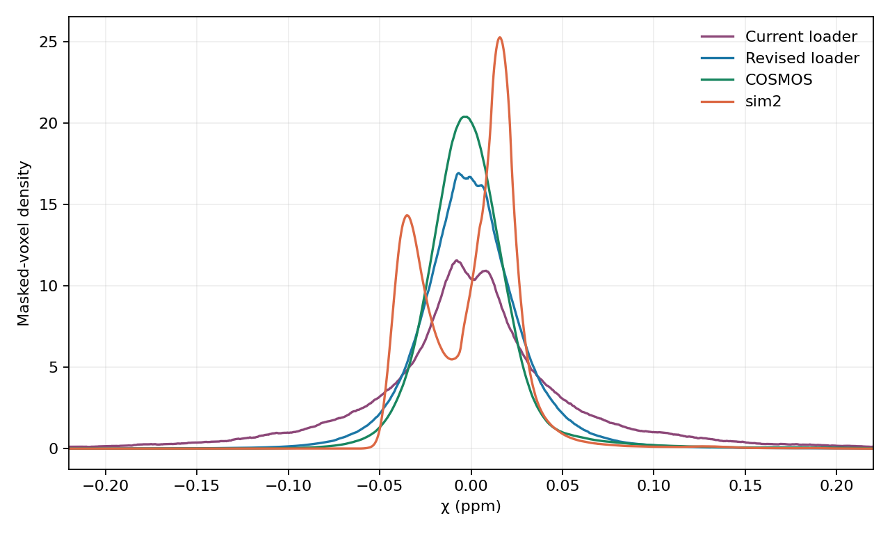
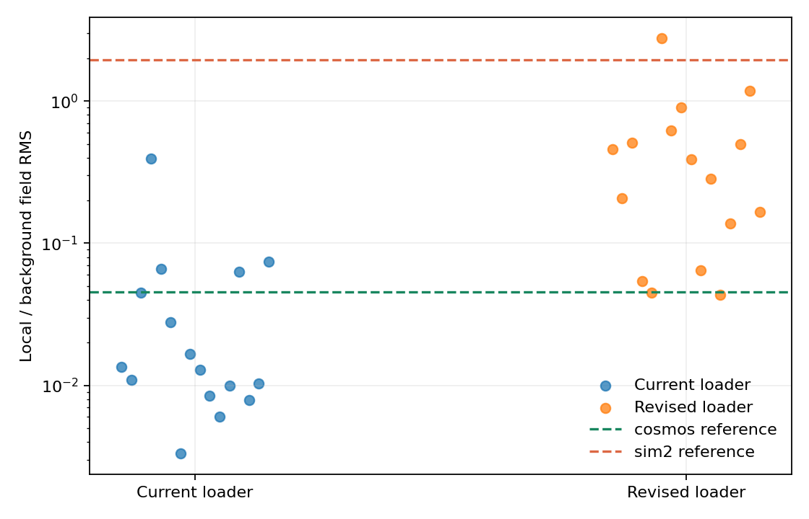

# Training susceptibility and field-scale audit

**Method.** Epoch-zero samples from the actual subject split and dataloader, seed 0.
The current path uses every training record once with χ multiplied by U(0.5, 3).
The revised path draws 927 original and 309 synthetic samples using the balanced sampler.
It draws each volume's masked χ RMS from 0.018–0.040 ppm (95%) or
0.040–0.080 ppm (5%). Spatial flips and permutations are
applied by `TrainingVolumes` in both paths. χ density and tails weight every masked
voxel equally; the RMS column is the median across sampled volumes for training
and the single-volume masked RMS for the references. COSMOS and sim2 are in
physical ppm. Field ratios use eight deterministic examples per training source
and mode; they illustrate coverage rather than an exhaustive field distribution.
Representative mask/χ slices are in the [generated data report](synthetic-data-report.md).

| Cohort | Samples | Median volume χ RMS (ppm) | χ p1 / p99 (ppm) | \|χ\| > 0.05 | \|χ\| > 0.10 |
| --- | ---: | ---: | ---: | ---: | ---: |
| Current loader | 1236 | 0.0518 | -0.1876 / 0.2036 | 29.0% | 11.0% |
| Revised loader | 1236 | 0.0279 | -0.0754 / 0.0881 | 8.3% | 1.0% |
| COSMOS | 1 | 0.0280 | -0.0556 / 0.1045 | 5.1% | 1.1% |
| sim2 | 1 | 0.0282 | -0.0453 / 0.0779 | 2.3% | 0.7% |

The existing loader's combined masked χ standard deviation is
**0.0662 ppm**; the revised mix is
**0.0308 ppm**. The revised sampler retains a broad tail while
placing more volume RMS values near the two references, both close to 0.028 ppm.
With each training volume weighted equally, χ p1/p99 changes from
-0.1895/0.2050 ppm to
-0.0755/0.0875 ppm.
The original and synthetic source summaries, including per-volume RMS quantiles,
are in [augmented_statistics.json](figures/training_distribution/augmented_statistics.json).
sim2 contains a rare negative extreme near -2.03 ppm; these central-range
sampling changes do not intentionally replicate that isolated tail. Its spatial
support should be checked before adding such extreme χ to training.
The revised loader has 48.6% positive masked voxels,
between COSMOS (45.6%) and sim2 (58.0%). Amplitude scaling does not
change this sign balance or replace their anatomical spatial patterns.
COSMOS's positive p99 (0.1045 ppm) remains
above the revised loader's (0.0881 ppm), so upper-tail
coverage is approximate.

## Field scales

| Reference | χ RMS | Local field RMS | Total phase RMS | Background or residual RMS | Local / background or residual |
| --- | ---: | ---: | ---: | ---: | ---: |
| COSMOS | 0.0280 | 0.0085 | 0.1871 | 0.1868 | 0.045 |
| sim2 | 0.0282 | 0.0086 | 0.0094 | 0.0044 | 1.948 |

For sim2, the residual is phase minus the dipole forward field from its χ
reference. It includes model mismatch and noise and is **not** a measured
background field. COSMOS uses its saved background reference.

The new synthesis draws a local/background RMS ratio log-uniformly from
0.03–3, spanning these two cases. A stronger phase normalization alone cannot
remove differences in the relative local and background fields. The network
now uses a 1e-6 input-scale floor, and the high-χ loss is normalized by each
target's masked RMS. Positive scaling of the full field should therefore be
approximately equivariant above the numerical floor. Changing only χ while
holding background fixed changes the inverse problem and must be handled by
the field-ratio sampling.

## Training decision

The paused run `artifacts/runs/joint_20261002_214544` clipped both branches on 100% of its 1873 logged updates. From epoch 1 to 7, real-subject χ NRMSE changed from 0.628 to 0.872, COSMOS from 0.504 to 0.723, and sim2 from 0.788 to 0.879. This does not isolate the data change from learning-rate or optimization effects. The earlier run also clipped both branches on 100% of updates, so clipping alone does not explain the decline. Its final learning rate was 5.0e-06; the declining run reached 9.8e-05.

Treat COSMOS and sim2 as development validation cases, never training voxels.
Compare same-initialization 60-iteration ablations for current sampling,
χ balancing, χ plus field-ratio balancing, and normalized high-χ loss.
Select using the worse of the two external χ NRMSE values relative to the
same 60-iteration baseline, while reporting real-subject validation and
gradient clipping. The current 60-iteration run worsened on the held-out
subjects as well as the external cases after epoch 2, so data distribution
alone is not yet a proven cause; optimization stability remains a competing
explanation. A full training run has not been launched by this audit.
